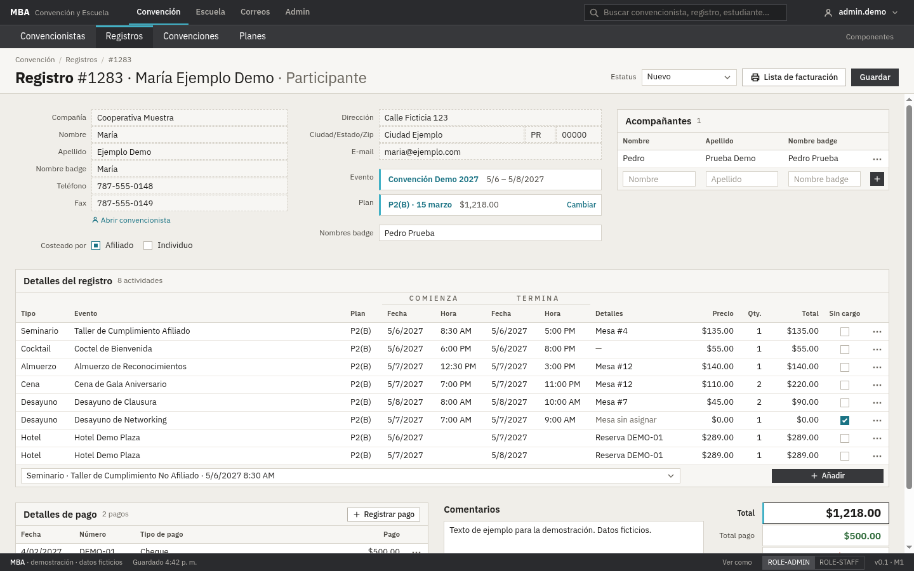
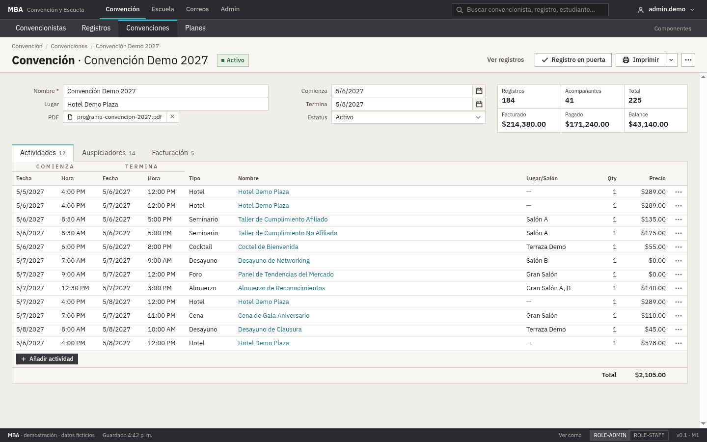
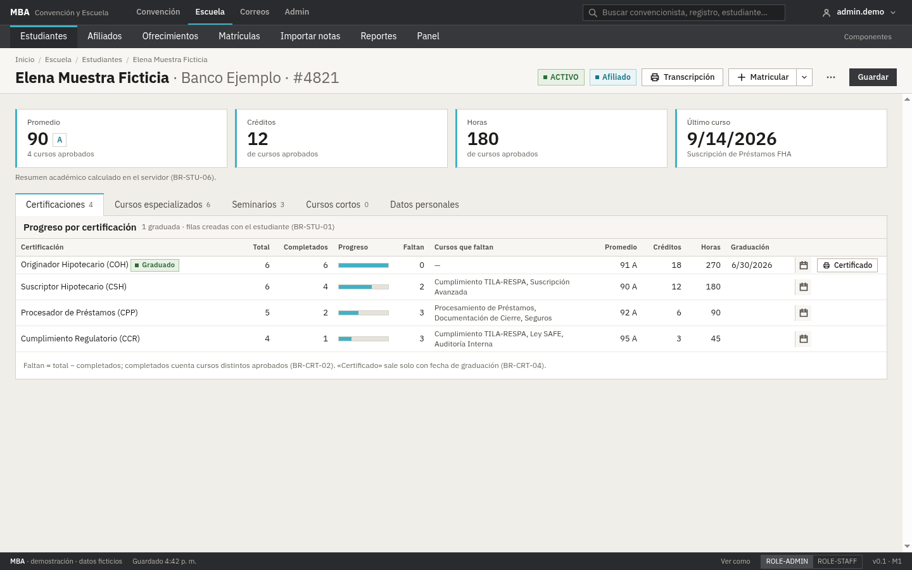
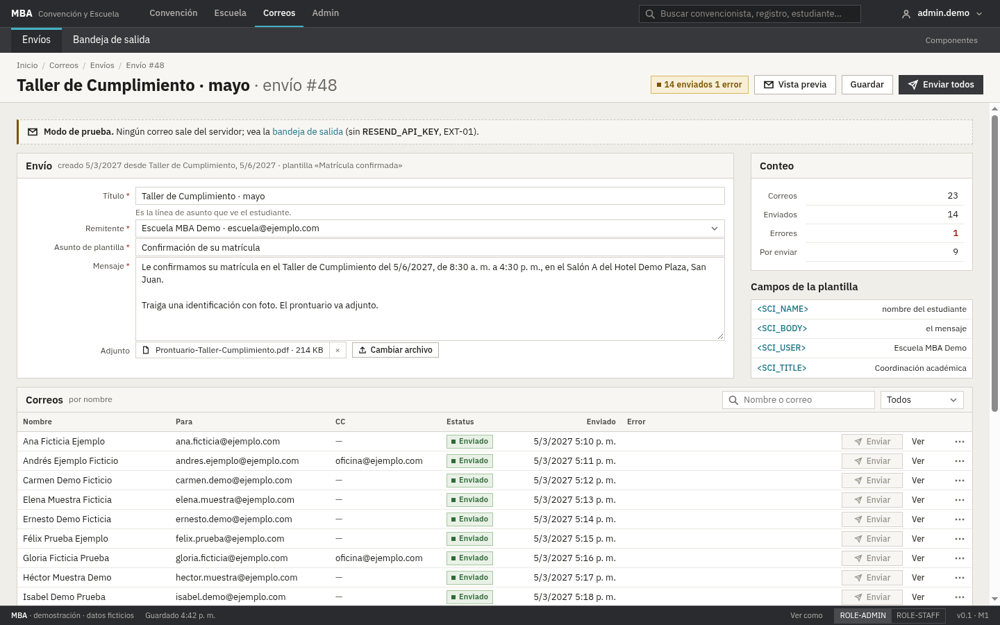
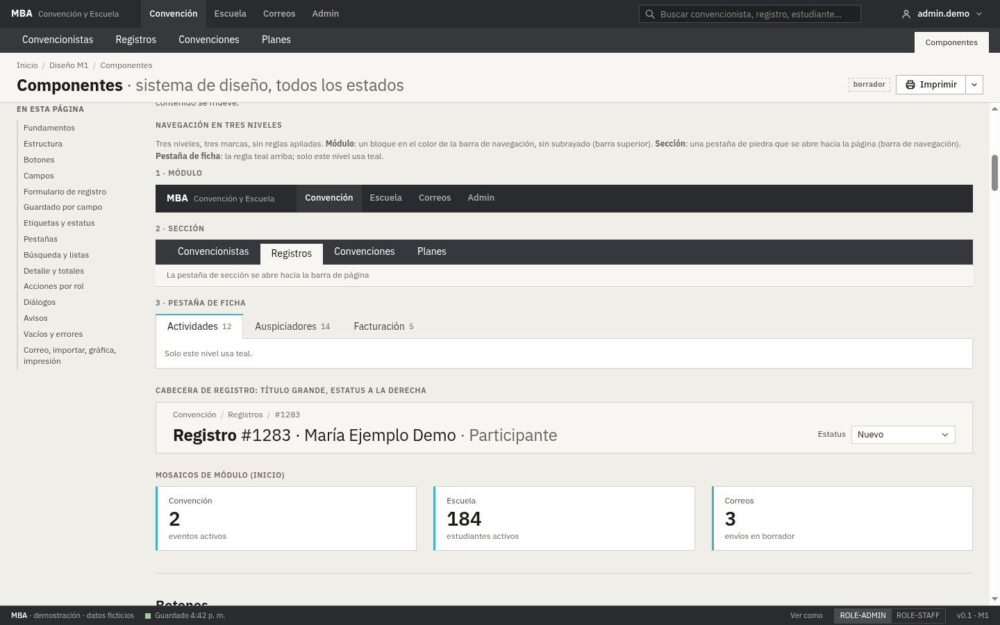

# migrate-mortgage-bankers-association

A demo of migrating a three-file FileMaker back office for a mortgage bankers association to one web app. The files are MBA (conventions and events), MBS (a school) and MBS_SendMail (bulk e-mail). All data in the demo is synthetic.

The repo holds the full migration plan and the clickable design pages for the new app. The app is not built yet.

## Where it stands

- The migration plan is done and audited.
- The M1 design is done. The operator approved it on 2026-11-23 and the epic ([#1](https://github.com/solutionscay/migrate-mortgage-bankers-association/issues/1)) is closed.
- The build is gated (G-BUILD) on the operator's approval of the promo video. No build work starts before that.

## How it was made

The plan was written with the [migrate-filemaker](https://github.com/solutionscay/migrate-filemaker) skill, run by agents in Skiff. The skill takes FileMaker's Database Design Report (DDR) apart into one text file per object, reads every object, and writes the plan from what the objects say.

The run:

- 3 FileMaker files with a DDR (FileMaker 26.0.3, exported 2026-11-13).
- 806 objects: 212 scripts, 181 layouts, 43 tables, 75 table occurrences, 57 relationships, 24 custom functions, 36 value lists, 111 custom menus and more.
- Steps 1-9 done, including the audit of the plan against the objects.

## Migration plan

### 00 Application summary

Inventory of the 3 files: object counts per file and kind, how the files reference each other, and a fourth file (`sci_admin`) that is outside the export.
[migration/00_app_summary.md](migration/00_app_summary.md)

### 01 Discovery answers

Owner questions on scope, users, data, integrations and secrets, each with the answer or the default assumed. The operator answered the scope questions for a demo build.
[migration/01_discovery_answers.md](migration/01_discovery_answers.md)

### 02 Recommendations

The target stack, checked against the constraints: Rust axum + askama + rusqlite, HTMX and SQLite, on the server base of [migrate-karbonfm](https://github.com/solutionscay/migrate-karbonfm) without Tauri. Ruby on Rails is the rejected alternative.
[migration/02_recommendations.md](migration/02_recommendations.md)

### 03 Migration plan

Scope, two milestones (M1, M2), the build gate, five increments (I1 to I5), tests and rollback.
[migration/03_migration_plan.md](migration/03_migration_plan.md)

### 04 Database schema

SQLite schema for the three modules in one database: 41 tables and 11 views. Money is stored as integer cents.
[migration/04_database_schema.sql](migration/04_database_schema.sql) · [appendix](migration/04_database_schema_appendix.md)

### 05 API design

The server-rendered routes (150), the operations behind them, the 72 print pages, and the one outbound integration (Resend, with an outbox mock when no key is set).
[migration/05_api_design.md](migration/05_api_design.md) · [appendix](migration/05_api_design_appendix.md)

### 06 UI specification

The screens (UI-01 to UI-35) mapped from the 181 FileMaker layouts, with the layouts that are merged or retired. The UI text stays in Spanish.
[migration/06_ui_spec.md](migration/06_ui_spec.md) · [appendix](migration/06_ui_spec_appendix.md)

### 07 Business logic

79 business rules and 62 operations recovered from the scripts and fields, each citing its object files and the tests it needs.
[migration/07_business_logic.md](migration/07_business_logic.md) · [appendix](migration/07_business_logic_appendix.md)

### 08 Auth and roles

Local sign-in with argon2id passwords, two roles (admin and staff), and 14 access policies (AP-01 to AP-14) with their tests.
[migration/08_auth_roles.md](migration/08_auth_roles.md) · [appendix](migration/08_auth_roles_appendix.md)

### 09 Audit

A second reader re-checked 75 rules against the objects (10 were wrong, all fixed) and listed what the plan still does not understand.
[migration/09_audit.md](migration/09_audit.md)

### Not in this repo

The plan cites object files and explorer catalogs. Those files come from the client's DDR and are not published here.

## Milestones and epics

| Id | Epic | State | What it delivers |
|---|---|---|---|
| M1 | [#1 Design milestone](https://github.com/solutionscay/migrate-mortgage-bankers-association/issues/1) | closed | Static HTML design pages: a component gallery and a page for every kept screen (UI-01 to UI-35), on synthetic data. |
| M2 | [#2 Promo video milestone](https://github.com/solutionscay/migrate-mortgage-bankers-association/issues/2) | open | A promo video made from the plan and the M1 design. It is not part of this repo. |
| I1 | [#3 Foundation](https://github.com/solutionscay/migrate-mortgage-bankers-association/issues/3) | open | The server runs, a user signs in, the seed tool fills a database. |
| I2 | [#4 Convention](https://github.com/solutionscay/migrate-mortgage-bankers-association/issues/4) | open | People, events, plans, registrations, payments, sponsors, billing, door check-in. |
| I3 | [#5 School](https://github.com/solutionscay/migrate-mortgage-bankers-association/issues/5) | open | Students, affiliates, courses, enrollments, grades, certifications. |
| I4 | [#6 Bulk e-mail](https://github.com/solutionscay/migrate-mortgage-bankers-association/issues/6) | open | Batches to enrolled students, templates, outbox, Resend adapter. |
| I5 | [#7 Print, reports and exports](https://github.com/solutionscay/migrate-mortgage-bankers-association/issues/7) | open | Every print document, the admin reports and the CSV exports. |

G-BUILD sits between M2 and I1: build work starts only after the operator approves the M2 video. I2 and I3 both depend on I1. I4 depends on I3. I5 depends on I2 and I3.

## Design

Static HTML design pages: a component gallery and a page for each of the 35 kept screens. Open [design/index.html](design/index.html) or [design/components.html](design/components.html) in a browser straight from disk. The pages need no network access. See [design/README.md](design/README.md) for the page table and the state hooks.

Visual direction: a three-level navigation (module in the top bar, section in the nav bar, record tab on the page), IBM Plex Sans on a warm stone canvas, teal as the one accent, and per-field autosave states.

| Registro (UI-06) | Convención (UI-09) |
|---|---|
|  |  |
| **Estudiante (UI-15)** | **Envío de correos (UI-26)** |
|  |  |

The three navigation levels in the component gallery:

## Key decisions

- **Platform:** one web app with one SQLite database for all three modules. Rust axum + askama + rusqlite, SSR with HTMX, a small vanilla JS file. No SPA, no JSON API.
- **Editing:** per-field autosave on the record pages.
- **Data:** no FileMaker data is migrated. A seed tool creates synthetic data.
- **Money:** stored as integer cents.
- **Users:** local username and password, two roles. FileMaker accounts are not mapped.
- **E-mail:** sent through Resend. With no API key set, mail goes to an outbox table.
- **Secrets:** no SMTP host, password or licence key from the source goes into the code, config or seed.
